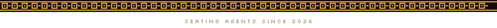

  

  <b>Full-stack software engineer working on multi-agent orchestration and AI harness engineering at Aegro.</b> 
  Angular · TypeScript · Java · Spring Boot, with a background in the fiscal and tax domain.

  
  
  

 

I'm a full-stack software engineer based in Porto Alegre, Brazil, with hands-on experience across the stack: Angular and TypeScript on the front end, Java and Spring Boot on the back end, and PostgreSQL and MongoDB for data.

Today I work on multi-agent orchestration and the AI harness at Aegro: the engine, guardrails and workflows that let coding agents plan, implement, test and review changes across several codebases, with human approval at the points that matter.

 

**Aegro**: Software Engineer
- **Multi-agent orchestration and AI harness** (current). I design and build the agent workflows that take a ticket to a reviewed draft pull request, plus the tooling around them: planning, code review, error triage and support automation.
- **Fiscal and tax domain.** I built full-stack features in the fiscal area, with Java and Spring Boot services and Angular front ends.

 

**Software Engineering**, PUCRS (Pontifical Catholic University of Rio Grande do Sul), 2022–2026

 

**[maître](https://github.com/danielrdg/maitre)** is a terminal orchestrator for Claude Code agents, with a pixel-art lounge where you watch them work. The idea: you write every request in one place, and each topic gets its own room, a real Claude Code session in its own git worktree, on the model that fits the job. A janitor closes idle rooms without ever losing work, and the one agent that needs you rings the bell.

It's early and being built in the open, milestone by milestone. Open source, MIT.

 

Selected AI automation work. These are internal tools, so they're described by what they do, not how they're built.

<table>
  <tr>
    <td width="50%" valign="top">
      
      <b>Issue in, reviewed PR out.</b> 
      An agent pipeline that reads a ticket, plans, implements, tests and reviews its own diff in the right codebase, then opens a draft pull request. One engine for backend, web and mobile stacks, tuned per repo by a profile. A human approves the plan and the PR; it never merges.
    </td>
    <td width="50%" valign="top">
      
      <b>A "press play" cockpit.</b> 
      A web console on top of that pipeline: pick an issue, read and edit the plan, approve it, and watch the run stream live. Planning runs without write access, and a run survives closing the tab.
    </td>
  </tr>
  <tr>
    <td width="50%" valign="top">
      
      <b>The long shift.</b> 
      A long, unsupervised work session: it takes open PRs to green, answers review requests, picks new work by explicit criteria and leaves a report at the end. It never merges, never approves its own PR, and never does anything irreversible without a human.
    </td>
    <td width="50%" valign="top">
      
      <b>Spec-driven planning.</b> 
      A planning flow that sizes itself to the task: discover, specify, design, tasks, delegate, verify, outcome. It writes the spec, hands execution to the agents above, and checks the feature against its success metrics after launch.
    </td>
  </tr>
  <tr>
    <td width="50%" valign="top">
      
      <b>Error janitor.</b> 
      Reads production error telemetry, dedupes by stack trace, separates user-facing bugs from noise, ranks what's left by frequency, impact and simplicity, and files ready-to-work issues.
    </td>
    <td width="50%" valign="top">
      
      <b>Support copilots.</b> 
      Agents that write help-center articles by checking every step in a staging environment, and that investigate support tickets end to end, gathering read-only evidence before drafting the answer.
    </td>
  </tr>
  <tr>
    <td width="50%" valign="top">
      
      <b>PR risk triage</b> (co-built) 
      A GitHub Action that labels every pull request low, medium or high risk from signals in the diff. A PR that edits the triage rules is always high risk.
    </td>
    <td width="50%" valign="top">
      
      <b>Side project: <a href="https://github.com/danielrdg/elysium">elysium</a>.</b> 
      The 24 voices of Disco Elysium as a Claude skill: one of them takes over Claude's voice for a few turns, then hands the mic to the next.
    </td>
  </tr>
</table>

 

  
  
  
  
  
  
  
  
  
  

 

  

Pixel art drawn in code for this profile. Lettering from Pixelify Sans and Silkscreen (SIL Open Font License), converted to shapes.
